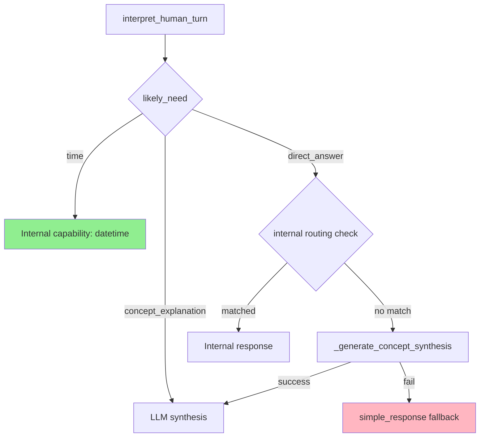
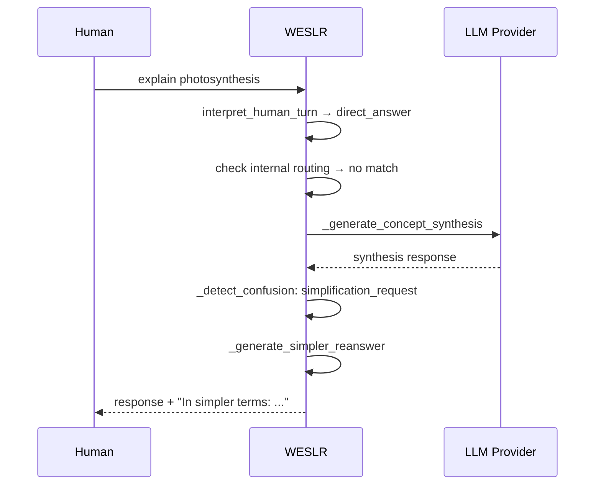

# WESLR — RESEARCH ARTIFACT GENERATION LAYER
**Date:** 2026-04-19
**Scope:** Architecture/design only — no code changes
**Branch:** main (clean, 18 commits ahead of origin)

---

## SECTION 1 — TARGET_OUTPUTS

WESLR's research artifact generation converts observations, evidence, and reasoning into human-usable scientific outputs. Each artifact type serves a different audience and requires a different evidence level.

### Artifact Types

| Artifact | Purpose | Evidence Required | Audience |
|---|---|---|---|
| **Research Memo** | Internal working record of an observation or hypothesis | Medium — observations + preliminary reasoning | WESLR operators, self-reference |
| **Technical Report** | Detailed documentation of a finding with full evidence chain | High — observations, methods, limitations, confidence | Engineers, researchers |
| **Scientific Paper Draft** | Structured paper with hypothesis, evidence, uncertainty, related work | Very high — full evidence chain, alternative interpretations, peer-reviewable | External researchers |
| **Seminar Outline** | Structured presentation of a finding for oral delivery | Medium — key points, visual aids, confidence markers | Conference/seminar audience |
| **Teaching Note** | Pedagogical explanation of a concept or finding with progressive complexity | Medium — multiple explanation levels, analogies, examples | Students, educators |
| **Diagram Pack** | Visual representations of reasoning paths, causal flows, timelines | Low-Medium — captures structure without full prose | All audiences |

### Evidence Level Definitions

**Low evidence:** Single observation, no cross-reference, LLM synthesis only.
**Medium evidence:** Cross-referenced observation, some internal state, partial verification.
**High evidence:** Multi-source verification (internal + external), confidence score, alternative interpretations documented, limitations stated.
**Very high evidence (paper draft):** All high requirements + peer-review structure, formal citations, uncertainty quantification.

---

## SECTION 2 — RESEARCH_PIPELINE

The pipeline converts raw inputs into structured artifacts through staged refinement.

```
question/hypothesis
    │
    ▼
evidence_collection
    ├── internal_state (quality_class, truth_guard, governance observations)
    ├── timeline_events (events.jsonl pattern analysis)
    ├── memory_anchors (targeted_anchors from sim)
    └── external_verification (if available, via research_context)
    │
    ▼
observation_summary
    ├── What was observed (raw event + metadata)
    ├── How confident WESLR is (quality_class at time)
    ├── What routing/fact-class applied (truth_guard)
    └── What the human/composer said/did (message context)
    │
    ▼
reasoning_inference
    ├── What WESLR concluded from the observation
    ├── What alternative interpretations exist
    ├── What internal state influenced the conclusion
    └── What is unknown / not concluded
    │
    ▼
confidence_probability_assignment
    ├── truth_class at time of observation
    ├── verification status (verified vs unverified)
    ├── quality_class (strong_verified / grounded_reasoning / weak_reasoning)
    └── Explicit probability estimate where applicable
    │
    ▼
diagrams_tables
    ├── Confidence table (class × verified × confidence)
    ├── Causal flow (what caused what)
    ├── Timeline (event sequence from events.jsonl)
    └── System reasoning path (which modules were involved)
    │
    ▼
artifact_generation
    └── LLM synthesis with evidence package → structured document
```

### Pipeline Design Principles

1. **Evidence precedes generation** — The pipeline never generates an artifact without first assembling the evidence package. LLM generation is the final formatting step, not the reasoning step.

2. **Confidence is explicit** — Every conclusion in the artifact carries its confidence/probability. The reader always knows how sure WESLR is.

3. **Limitations are structural** — Every artifact includes a limitations section. This is not optional or editorial — it's part of the artifact schema.

4. **Reproducibility** — Artifacts include enough context that a future WESLR session or human could reproduce or verify the finding.

---

## SECTION 3 — MINIMUM_FIRST_VERSION

**Safe first implementation:** Bounded **research memo generator** only.

This is the safest artifact type because:
- Internal working record, not external publication
- Medium evidence requirement — uses existing WESLR state
- No peer-review requirement
- Easily auditable by operator
- Bounded output — can be limited to ~800 words

### Research Memo Schema

```python
{
    "title": str,                    # Human-readable title
    "research_question": str,         # What WESLR was trying to understand
    "context": str,                   # Why this question matters, what's known
    "observations": [                 # Factual observations from WESLR state
        {
            "event": str,            # What was observed
            "source": str,           # events.jsonl / internal state / external
            "timestamp": str,
            "quality_class": str,
            "truth_class": str,
        }
    ],
    "hypothesis": str,               # WESLR's current interpretation
    "supporting_evidence": [str],    # Evidence supporting the hypothesis
    "confidence": {
        "level": "high/medium/low",
        "truth_class": str,          # model_reasoning / system_fact / etc.
        "verified": bool,
        "explanation": str,         # Why this confidence level
    },
    "limitations": [str],            # What's not known, what could be wrong
    "alternative_interpretations": [str],  # What else this could mean
    "next_experiment": str,          # What would confirm or refute the hypothesis
    "generated_by": "weslr",
    "generated_at": str,             # ISO timestamp
}
```

### Evidence Collection for Research Memo

The memo uses existing WESLR state as evidence:
- **Events from timeline** (`events.jsonl`): governance observations, confusion signals, quality watch fires
- **Internal state**: `_quality_class`, `_truth_guard`, `_response_signals` from recent sessions
- **Anchor context**: `targeted_anchors` from memory layer
- **Governance candidate/recommendation**: from the governance pipeline already built

This means the memo generator uses already-collected data — it doesn't trigger new observation gathering.

### LLM Generation Prompt Structure

```
You are WESLR's research memo generator. Generate a structured research memo from the following evidence package.

Title: {title}
Research Question: {research_question}
Context: {context}

Observations:
{foreach observation in observations}
- [{timestamp}] {event} (quality={quality_class}, truth={truth_class})
{/foreach}

Hypothesis: {hypothesis}

Generate a research memo with sections:
1. Summary (2-3 sentences)
2. Observations (bullet list)
3. Analysis (paragraph explaining the hypothesis)
4. Confidence Assessment (explicit confidence level with reasoning)
5. Limitations (what's unknown or could be wrong)
6. Alternative Interpretations (what else this could mean)
7. Next Steps (what would confirm or refine the hypothesis)

Rules:
- Be precise about confidence levels — do not overstate certainty
- If evidence is weak, say so explicitly
- Do not invent evidence not in the observations
- Use plain scientific language
```

### Safe Boundaries for First Version

- Output capped at ~800 words
- No external web search (only internal WESLR state)
- No automatic publication — operator reviews before any external use
- Only generates from evidence WESLR already has (no new observation collection)
- Memo is labeled as draft — not peer-reviewed

---

## SECTION 4 — VISUAL_LAYER

Visual diagrams in WESLR serve as structural summaries — they capture reasoning paths, not artistic renderings.

### First Priority Diagrams (from existing WESLR state)

**1. Confidence Matrix Table**
- Rows: query types or time periods
- Columns: quality classes (strong_verified, grounded_reasoning, weak_reasoning, fallback, uncertain)
- Cells: count of events
- Source: events.jsonl quality_class counts
- Why first: WESLR already tracks quality_class — this is a direct conversion, no new observation needed

```
| Time window | strong_verified | grounded_reasoning | weak_reasoning | fallback |
|-------------|-----------------|---------------------|----------------|----------|
| last hour    | 12              | 8                   | 3              | 1        |
| last day    | 89              | 34                  | 12             | 7        |
```

**2. Governance Event Timeline**
- Horizontal timeline of governance events (governance.observation, confusion.signal, adaptive.hint)
- Color-coded by event type
- Source: events.jsonl filtered by event_type
- Why useful: operators can see the sequence of governance observations

```
governance.observation [routing_gap] ─── confusion.signal [simplification_request] ─── governance.observation [weak_reasoning_pattern]
```
ASCII representation:
```
●────●────●────●────●
governance.obs    confusion.signal   governance.obs    adaptive.hint
(routing_gap)     (simpl_req)       (weak_pattern)   (simpler_reanswer)
```

**3. Reasoning Path Diagram**
- Shows which modules were involved in processing a specific query
- Source: _response_signals.path, interpret_human_turn result, likely_need
- Simple block diagram: `interpret_human_turn → [need routing] → [capability/internal/synthesis/fallback] → response`

**4. Quality Watch Streak Display**
- Simple bar or count display of current streak state
- Source: _WATCH_HISTORY
- Shows: current quality_class, count, gap_to_threshold

### Diagram Generation Method

- Use Mermaid.js-compatible text format for structured diagrams
- Can be rendered in any Mermaid-compatible viewer
- Stored as markdown code blocks in artifacts
- No heavy diagram library — text-format first, visual rendering optional

### Mermaid Schema Examples

```markdown




### Build Order for Diagrams

1. **Confidence Matrix Table** — direct conversion of existing quality_class counts
2. **Quality Watch Streak** — uses existing _WATCH_HISTORY state
3. **Governance Event Timeline** — filtered events.jsonl display
4. **Reasoning Path Diagram** — uses _response_signals.path + interpret_human_turn
5. **Mermaid Sequence Diagrams** — for complex multi-step interactions

---

## SECTION 5 — HUMAN_LEARNING_MODE

The same research artifact should be renderable at multiple complexity levels for different audiences.

### Rendering Modes

**1. Researcher Mode**
- Full detail, all evidence, all limitations
- Includes technical schema, confidence levels, uncertainty quantification
- Assumes audience understands WESLR's architecture
- No simplification — presents WESLR's reasoning at full fidelity

**2. Student Mode**
- Progressive disclosure: starts with simplified summary
- Uses analogies and concrete examples
- Explicitly labels technical terms and explains them
- Hides or footnotes low-confidence speculation
- Ends with "What WESLR concluded and why"

**3. Seminar/Presentation Mode**
- 10-15 slide-ready sections
- Key finding up front
- Visual diagrams prominent
- Speaker notes suggested
- Interactive: "Questions WESLR would ask about this finding"

### Adaptive Rendering Implementation

The memo generator produces a canonical structured document. A separate rendering layer converts it to the appropriate mode:

```python
def render_artifact(artifact: dict, mode: str) -> dict:
    """Render a research artifact in the specified mode.
    
    Modes:
    - researcher: full detail, all sections
    - student: progressive disclosure, simplified language
    - seminar: slide-ready, visual-first
    """
    base = artifact.copy()
    
    if mode == "student":
        # Add summary_up_front, simplify language,
        # add analogies, hide speculative sections
        base["render_mode"] = "student"
        base["disclosure_level"] = "progressive"
        base["simplified_summary"] = summarize_for_student(artifact)
    elif mode == "seminar":
        # Reshape into slide structure, expand visuals
        base["render_mode"] = "seminar"
        base["slide_sections"] = to_slides(artifact)
        base["speaker_notes"] = generate_speaker_notes(artifact)
    else:
        base["render_mode"] = "researcher"
    
    return base
```

### Teaching Interaction Pattern

WESLR's teaching mode should support dialogic learning, not just one-directional output:

**Teaching flow:**
1. WESLR presents finding (student mode)
2. Human asks a question or challenges
3. WESLR detects confusion signal → offers clarification
4. WESLR updates its understanding if human provides correction
5. Teaching note is updated with new human input

This mirrors the human-WESLR co-evolution principle from GRADUATED_AUTONOMY_DOCTRINE_v1.md — WESLR learns from humans too.

---

## SECTION 6 — BUILD_ORDER

Implementation from smallest/safest to larger/more powerful:

### Phase R1 — Research Memo Generator (safe first)
1. Implement `generate_research_memo(evidence_package: dict) -> dict`
   - Input: events.jsonl data + internal state + governance observations
   - Output: research memo in schema from Section 3
2. Add `_research_memo` metadata to responses when memo is generated
3. Add `GET /api/research/memos/recent` endpoint (read-only, bounded)
4. No external publication — operator reviews only

### Phase R2 — Artifact Rendering Modes
1. Add `render_artifact(memo, mode)` with researcher/student/seminar modes
2. Student mode: automatic simplification with progressive disclosure
3. Seminar mode: slide structure generation
4. No new storage — rendering is a transformation of existing memo data

### Phase R3 — Confidence Matrix Diagram
1. Add `_generate_confidence_matrix()` using events.jsonl quality_class counts
2. Output as Mermaid markdown table
3. Add as section to research memo
4. Add as standalone `GET /api/diagrams/confidence-matrix`

### Phase R4 — Governance Event Timeline Diagram
1. Add `_generate_governance_timeline()` using events.jsonl filtered by event_type
2. Output as Mermaid gantt or sequence diagram
3. Add to memo as governance section
4. Add as standalone `GET /api/diagrams/governance-timeline`

### Phase R5 — Reasoning Path Diagram
1. Add `_generate_reasoning_path()` using _response_signals.path + interpret_human_turn result
2. Output as Mermaid flowchart
3. Add to memo as process section
4. Add as standalone `GET /api/diagrams/reasoning-path`

### Phase R6 — Research Memo with Visual Bundle
1. Combine memo + all diagrams into a single structured artifact
2. Output format: markdown with embedded Mermaid diagrams
3. Add `GET /api/research/artifacts/recent?include_diagrams=true`
4. Still operator-only review — no external publication

### Phase R7 — External Publication Gateway (requires governance)
1. Add governance approval step before any external distribution
2. Require explicit operator approval for: research memo → paper draft conversion
3. Add paper draft schema with: abstract, introduction, methods, results, discussion, references
4. Implement confidence scoring with probability distribution per claim
5. Add limitations review step — human must approve limitations section

---

## SECTION 7 — EXACT_NEXT_STEP

**Implement Phase R1: Bounded research memo generator.**

```python
def generate_research_memo(
    title: str,
    research_question: str,
    observations: list[dict],
    hypothesis: str,
    context: str = ""
) -> dict:
    """Generate a bounded research memo from WESLR evidence package.
    
    Uses existing WESLR state as evidence (no new observation collection).
    Output capped at ~800 words. Operator review required before any external use.
    """
    # Assemble evidence package from existing WESLR state
    # Generate via get_provider().generate() with structured prompt
    # Parse and structure output into memo schema
    # Add confidence assessment, limitations section
    # Return dict conforming to research memo schema
```

This is the smallest first step because:
- Uses existing infrastructure (get_provider().generate())
- Uses already-collected evidence (no new observation gathering)
- Bounded output (~800 words)
- No external effects — operator reviews before any use
- Easy to validate — can test with existing events.jsonl data
- Establishes the evidence-before-generation principle for all future artifact types

After this, the rendering modes (Phase R2) can be added without changing the memo generator itself — they just transform the output into different formats for different audiences.