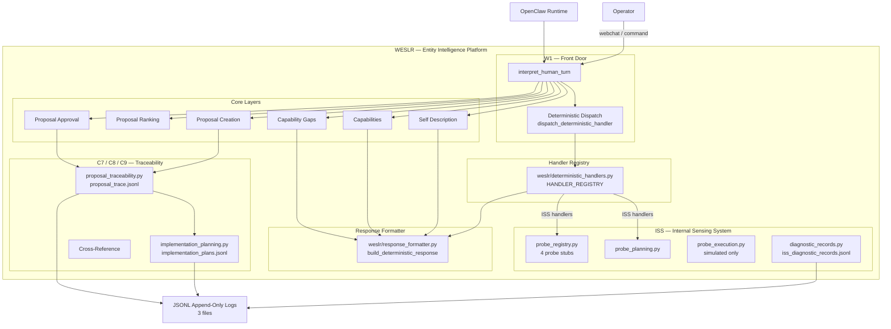
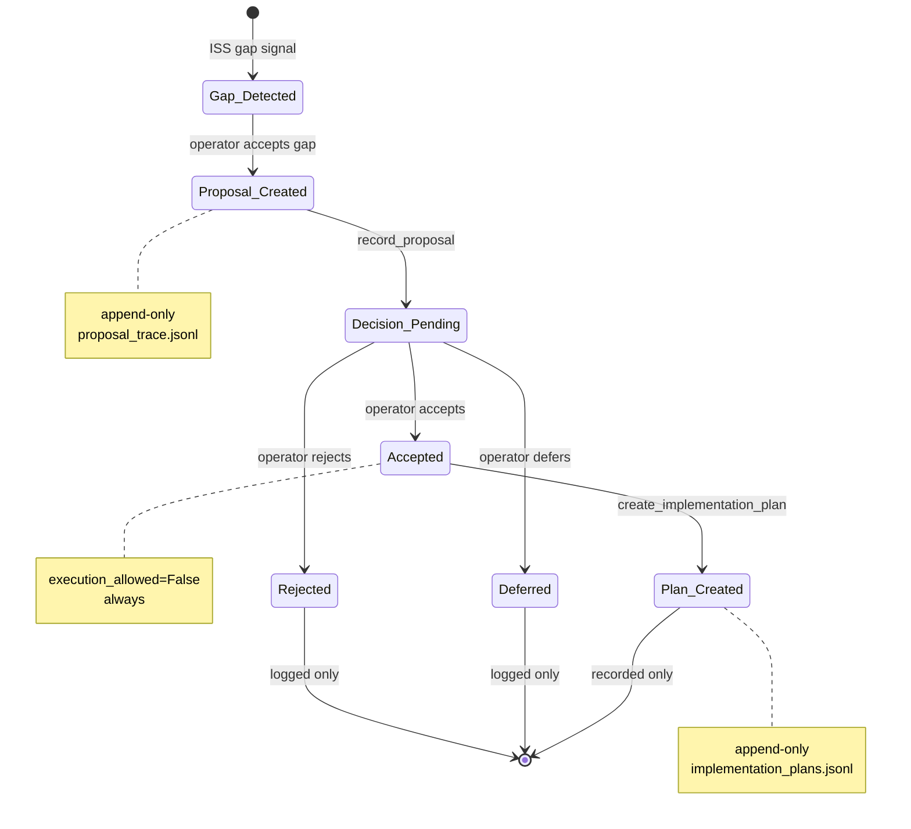
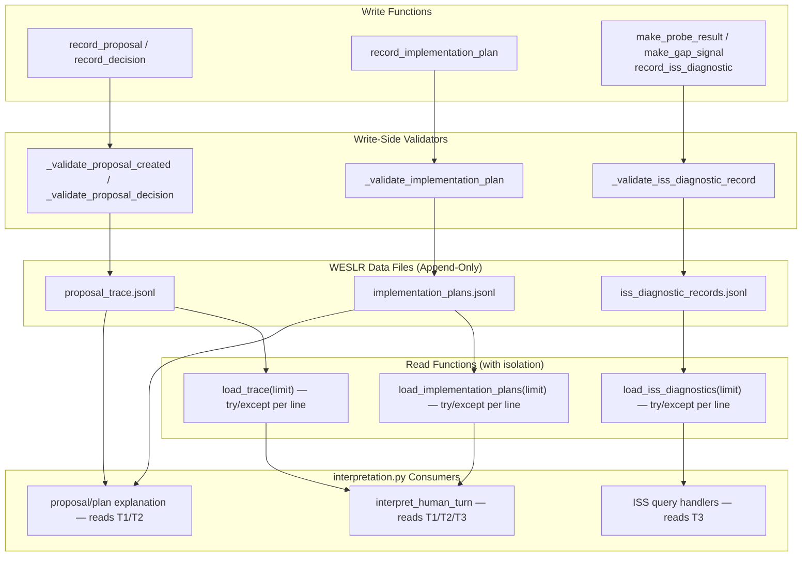

# WESLR Architecture Diagrams — V1

**Version:** 1.0
**Status:** active reference
**Created:** 2026-04-27

All diagrams use [Mermaid](https://mermaid.js.org/) syntax. Render in any Mermaid-compatible viewer (GitHub, GitLab, Mermaid Live Editor).

---

## D1 — High-Level WESLR Layer Diagram



**Key:** WESLR sits on OpenClaw. Front door routes to deterministic dispatch or core layers. ISS is a self-contained subsystem that never executes. All state is append-only in JSONL.

---

## D2 — Proposal Lifecycle Diagram



**Key:** Proposals are created by operator intake (ISS gap acceptance) or explicit command. Decisions are always operator-driven. Plans are created from accepted proposals but never executed in current phase. All transitions are logged.

---

## D3 — ISS Diagnostic Flow

```mermaid
flowchart LR
    subgraph ISS_Query["ISS Read-Only Query Path"]
        Q1["show iss probes"]
        Q2["show gaps"]
        Q3["show diagnostics"]
        Q4["show probe results"]
    end

    subgraph ISS_Probe["ISS Probe Subsystem (non-executing)"]
        REG[get_probe_registry<br/>4 probes defined]
        PLAN[create_probe_plan<br/>declarative plan]
    end

    subgraph ISS_Record["ISS Diagnostic Records"]
        DIAG[load_iss_diagnostics]
        PROBE[make_probe_result<br/>status: ok|degraded|missing|unknown]
        GAP[make_gap_signal<br/>severity: low|medium|high]
    end

    subgraph ISS_Execution["Simulated Execution"]
        SIM[execute_probe_simulated<br/>mode: simulated<br/>no real I/O]
        SIM --> |writes| DIAG
    end

    Q1 --> REG
    Q2 --> DIAG
    Q3 --> DIAG
    Q4 --> DIAG
    Q1 --> PLAN
    REG --> PLAN
    REG --> SIM
    SIM --> PROBE
    PROBE --> DIAG
    GAP --> DIAG

    DIAG --> JSONL["iss_diagnostic_records.jsonl<br/>append-only"]
```

**Key:** ISS has three modes: registry query (read), probe planning (declarative), simulated execution (writes one probe result). All execution is simulated. No real file inspection or network access.

---

## D4 — Handler Dispatch Flow

```mermaid
flowchart TB
    IN["interpret_human_turn(message)"]
    L["lowered = message.lower()"]

    IN --> L
    L --> DD["dispatch_deterministic_handler(message, lowered)"]

    DD --> SORT["sorted(HANDLER_REGISTRY, key=priority, reverse=True)"]
    SORT --> FOR_EACH["for entry in sorted_handlers"]
    FOR_EACH --> MATCH["entry.triggers × lowered.startswith?"]
    MATCH --> |match| FN["handler_fn(message, lowered)"]
    MATCH --> |no match| FOR_EACH
    FN --> RF["build_deterministic_response(...)"]

    RF --> OUT["return result dict"]

    note right of MATCH
        Priority ordering:
        85 = iss_probe_plan
        80 = iss_probe_registry_query
        50 = generic plan (if added)
    end

    note left of OUT
        Returns: message, response_text, path,
        _weslr_deterministic, confidence,
        suggested_mode, payload
    end
```

**Key:** Dispatch sorts the registry by priority descending before evaluation. First matching trigger wins. Returns via formatter for extracted handlers.

---

## D5 — Data Files / Append-Only Logs Diagram



**Key:** All writes go through validators. All reads use line-level error isolation. No direct JSONL mutation. Each file is read by specific consumer handlers.

---

## Layer Status Summary

| Layer | ID | Status |
|---|---|---|
| Front Door | W1 | Active |
| Self Description | C1 | Active |
| Capabilities | C2 | Active |
| Capability Gaps | C3 | Active |
| Proposal Creation | C4 | Active |
| Proposal Ranking | C5 | Active |
| Proposal Approval | C6 | Active |
| Proposal Traceability | C7 | Active |
| Implementation Planning | C8 | Active |
| Proposal/Plan Linkage | C9 | Active |
| ISS | ISS | Active |
| Handler Registry | — | Partial (2 entries) |
| Response Formatter | — | Partial (5 handlers) |

---

*Architecture Diagrams V1 — 2026-04-27*
*Mermaid diagrams — render in Mermaid Live Editor or compatible viewer*
